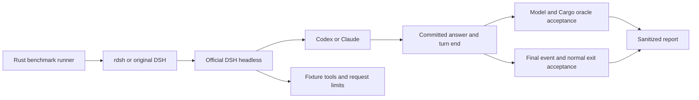

# Codex / Claude ランタイムベンチマーク

Rust製 `examples/benchmark_models.rs` のオプトイン実行機が、実 `rdsh` 実行可能物を通してインストール済みの公式DSHヘッドレスプロファイルへ委譲します。エージェントループを自前実装せず、プロバイダAPIも独立に呼びません。CIはオフラインの受け入れとfenceテストだけを実行し、モデルクレデンシャルは決して使いません。

[2026-10-08の結果](https://github.com/jimoto-no-llm/rustdsh/blob/main/docs/evidence/model-runtime-20261008.md) には失敗が含まれ、モデルcompletionと正常なヘッドレスシャットダウンが別々に評価されます。



## ローカル実行

前提: cleanなcommit済みcheckout、Rust/Cargo、`zstd`、`shasum`、`headless --json` 付きのインストール済みDSH、既存の認証済みクレデンシャルストア。プロバイダカタログは `openai-codex` と `anthropic` を鍵にした非秘密JSONで、公式の互換メタデータ込みで `gpt-6.1-sol` と `claude-sonnet-5-5` を含める必要があります。

```sh
cargo build --release --example benchmark_models --bin rdsh
cargo run --release --example benchmark_models -- \
  --bin ./target/release/rdsh \
  --original /absolute/path/to/original/dsh \
  --credentials /absolute/path/to/existing/.credentials.yaml \
  --catalog /absolute/path/to/non-secret/provider-catalog.json \
  --out /absolute/path/to/a/new/run-directory \
  --samples 3 --timeout-seconds 120
```

Desktopランタイムは必要なら `--runtime-artifact` で `app.asar` パスを追加します。報告はRustバイナリ・元ランチャ・任意のruntime bundleをSHA-256で指紋化し、両バージョンとソースcommitを記録します。実走行ランナーはmacOSで検証済み、オフラインRustテストはリポジトリの Linux/macOS/Windows マトリクスで動きます。実行ごとに新しいrunディレクトリが必要です。

`--only-case rust_fix` と `--only-provider anthropic` で限定した後追跡もできます。フォローアップ結果は元ベンチマークとは別物です。

## 条件と受け入れ

| 条件 | ランチャ | 独立した受け_acceptance |
| --- | --- | --- |
| 短い算数応答 | 元DSH と rdsh | 正確なnonceと和、turn完成、exit 0 |
| 合成JSONの読み取り | rdsh | ファイルツール成功、隠しnonceと和、fixture不変 |
| Rustの範囲境界の修復 | rdsh | ファイルツール成功、修復前にテスト失敗、修復後に1,001入力でテスト合格 |

両モデルとも `high` 推論effortです。保存済み要求ヘッダがeffortと告知ツールを検証し、セッション要求コンテキストが選択経路を検証します。Rust修復は意図的に包括範囲か算数式の実装形に限定されます。外部Cargoオラクルで実行可能なのは4つの審査済み実装形のみで、任意の生成Rustはコンパイル前に拒否されます。汎用コード品質ベンチマークではなく、機能回帰の演習です。

各モデル/サンプルは、元応答・rdsh応答・rdsh読取・rdsh修復の4条件です。サンプル3つは**24 runs**、最大48のagent request preparationになります。読取/修復は通常数ステップのprovider呼び出しです。要求上限はそれぞれ1/2/4で、走行ごとにプロセスタイムアウトもあります。公式プロバイダのリトライ上限は0に設定され、リトライ試行イベントは受け入れ失敗にします。provider間・応答ランチャの順序はサンプルごとに交替し、走行は逐次で、初期に空のNode compile cacheを共有します。

## 分離と保存証拠

`HOME`、`DSH_HOME`、セッション、作業ファイルは走行ごとに専用化されます。モデルプロセスはクリアされた環境とpath/locale/cache許可リストで起動し、公式credential providerには既存ストアのパスだけを渡します。通常のOAuth refreshでそのストアが更新されることはあります。クレデンシャル値は書き出さず、fixtureに複製せず、報告に含めません。既存プロファイルを編集しません。

小さな `.mjs` fenceは公式Nodeツールレジストリへの単純アダプタであり、announceされるツールの制限、既存正準fixtureパスへの単調ガード、公式モデル呼び出し前のrequest preparation上限だけを持ちます。benchmarkのfixtures、オーケストレーション、subprocess制御、受け入れ、統計、報告はすべてRust側です。これらのテストではシェル、web、delegation、plugins、skills、telemetry、自動LLM titleを無効化します。

経路/使用量の抽出とoracle検証の後、runnerは走行ごとのworkspace、生セッション、profile、patch、home、Cargoビルド出力を、エラー時も込みで削除します。保持するのは正格化した `result.json` と集計 `report.json` だけです。モデル推論、生ツールペイロード、エラー文言、stderrは出版しません。

## 測定値の読み方

応答時間はプロセス起動から `turn_end` の確定までで、DSH起動・ネットワーク・モデル時間込みです。プロセス寿命も別に記録します。turnが終わったのに2秒以内にexitしなければ、runnerは自プロセスグループをterminateし `shutdown_timeout` を記録します。runtime受入はその点で失敗と評価します。`model_passed` は、正確な確定回答、turn完成、ツール、独立oracle、経路、effort、catalog、試行の検証が必要です。`passed` はさらに、公式の最終イベントとクリーンなプロセスexitを要求します。モデル応答が壊れたヘッドレスシャットダウンを隠さないよう別結果にします。`first_committed_text_seconds` はcommit済みアシスタントメッセージ全体の初回到達時刻で、公式JSON投影は初トークン時刻を出しません。TTFTとは呼ばず、生成速度をそこから導き出しません。

報告には全試行と失敗、成功のnearest-rank p50/p95/max、ツール数、ステップ数、記録されたprovider試行、ステップ別の報告token使用量が入ります。cached tokensは供給があれば別々に記録します。サンプル3つではp95は最大値と等しく、この実行では安定した尾部遅延もモデル順位もRustランチャの頭上負担も立証しません。ランチャ頭上負担は [BENCHMARKS.md](https://github.com/jimoto-no-llm/rustdsh/blob/main/docs/BENCHMARKS.md) のローカル起動ベンチで測るように案内があります。JSONの `median_success_seconds` はnearest-rank p50です。Rust修復は `generated_source_allowed` と `cargo_oracle_passed` も記録し、`null` はoracle未実行を意味します（合格ではない）。

## 実務上の注意

- 目指す用途は「経路の効果と失敗のあり方を観察すること」です。3サンプルではp95が最大値と等しいため、安定した尾部遅延・モデル順位・Rustランチャの頭上負担の根拠にはなりません。
- モデルcompletionとシャットダウンを別結果にする設計のおかげで、応答良好の中に隠れているヘッドレスの死を確実に摘み取れます。CI報告は `passed` を重要視してください。

## 出典

UPSTREAM: https://github.com/jimoto-no-llm/rustdsh/blob/main/docs/MODEL_BENCHMARKS.md
